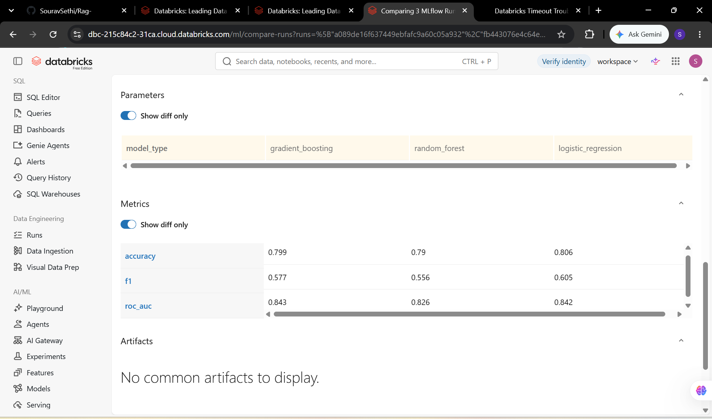
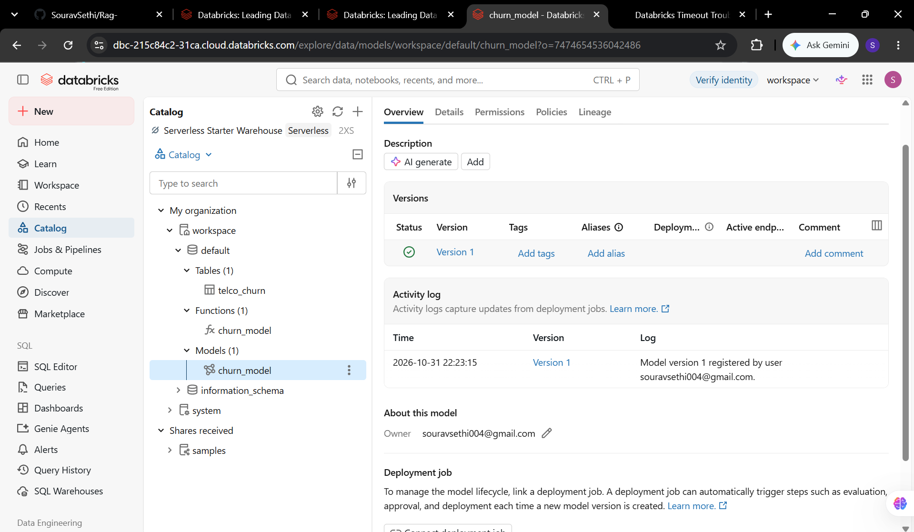
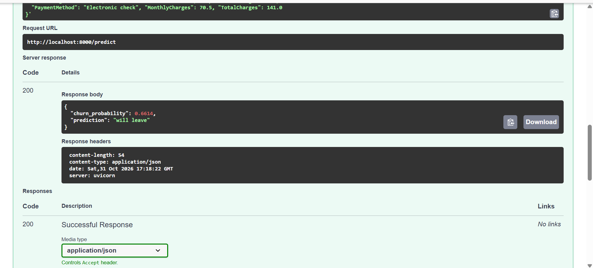

# End-to-End ML Pipeline: Databricks, MLflow and FastAPI

Customer churn prediction pipeline: data preparation on Databricks (SQL and Pandas),
experiment tracking and model registry with MLflow, and a Dockerized FastAPI
prediction service with Pydantic input validation.

## Pipeline
1. **Data:** Telco Customer Churn dataset (Kaggle), explored with SQL and cleaned with Pandas on Databricks (missing-value handling, target encoding, one-hot encoding).
2. **Training:** Logistic Regression, Random Forest and Gradient Boosting (scikit-learn) on a stratified 80/20 split, with parameters, metrics and models logged to MLflow.
3. **Registry:** the best model by ROC-AUC registered in the MLflow Model Registry (Unity Catalog) as `churn_model`.
4. **Serving:** FastAPI `/predict` endpoint with Pydantic validation, packaged in Docker.

## Results
| Model | Accuracy | F1 | ROC-AUC |
|---|---|---|---|
| Logistic Regression | 0.806 | 0.605 | 0.842 |
| Random Forest | 0.790 | 0.556 | 0.826 |
| Gradient Boosting | 0.799 | 0.577 | 0.843 |

Best model by ROC-AUC: Gradient Boosting (0.843). Logistic Regression was nearly tied (0.842).

## Project structure
```
churn-api/
  databricks_notebook.ipynb   # data exploration, cleaning, training, MLflow tracking, registration
  app.py                      # FastAPI service with Pydantic input validation
  columns.json                # feature columns the model expects
  model/model.pkl             # exported registered model (Gradient Boosting)
  requirements.txt
  Dockerfile
  screenshots/
```

## Run the API
```
docker build -t churn-api .
docker run -p 8000:8000 churn-api
```
Open http://localhost:8000/docs and call `POST /predict`.

Example response for a new month-to-month customer on fiber:
```json
{
  "churn_probability": 0.6614,
  "prediction": "will leave"
}
```

## Screenshots




## Tech stack
Python, Databricks, SQL, Pandas, scikit-learn, MLflow, FastAPI, Pydantic, Docker
